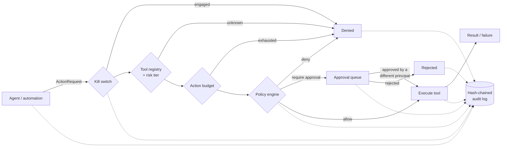

# Governed Agentic Platform

A reference runtime for enterprise systems where AI agents and automations take real actions: refunds, emails, record changes, configuration pushes.

This repository is a companion implementation of the paper:

> **M. H. Sazu (2023).** *A Full-Stack Production-Platform Reference Architecture for Governed Agentic and Automated-Action Enterprise Systems.* IPHO Journal of Advance Research in Science and Engineering, 1(12), 377.

The paper describes the architecture. This code shows its control plane working end to end: every action an agent requests is checked by policy, can be routed to a human approver, can be stopped by a kill switch, and is recorded in a tamper-evident audit log.

## Architecture



| Layer | Module | What it does |
|---|---|---|
| Action model | `gap/actions.py` | `ActionRequest`, `ActionResult` and four risk tiers (READ, LOW, MEDIUM, HIGH) |
| Policy | `gap/policy.py` | Declarative rules by tool, agent, risk tier or custom condition. The most restrictive matching verdict wins, and the default is deny |
| Human-in-the-loop | `gap/approvals.py` | Queue of actions waiting for approval |
| Control plane | `gap/runtime.py` | Kill switch, per-agent action budgets, separation of duties, execution and failure capture |
| Audit | `gap/audit.py` | Append-only SHA-256 hash chain. Editing or deleting any entry fails `verify()` |

### Design principles

- **Default deny.** An action no rule covers does not run.
- **Fail closed.** A policy condition that throws an error can never produce an allow.
- **Separation of duties.** An agent cannot approve its own request.
- **Kill switch wins.** It blocks new requests and also approved requests that haven't executed yet.
- **Everything is evidence.** Requests, decisions, approvals, rejections, executions and failures are all logged.

## Quick start

```bash
pip install -e ".[dev]"
python -m gap.demo
pytest
```

Demo output (a support agent with order lookup, email and refund tools):

```
lookup order A100                          -> executed          {'customer': 'c-17', 'total': 42.0}
refund $25 on A100                         -> executed          refunded $25.00 on A100
refund $300 on A200                        -> pending_approval  refunds over $100 need a human approver
  ...approved by supervisor                -> executed          refunded $300.00 on A200
refund $99 on A100 (exceeds $42 total)     -> failed            refund exceeds order total
delete customer c-17                       -> denied            agents may not take HIGH-risk actions
email while kill switch engaged            -> denied            kill switch engaged
```

## Using it with an LLM agent

Register your tools with a risk tier, then route the agent's tool calls through `GovernedRuntime.submit()` instead of calling the tools directly:

```python
from gap import GovernedRuntime, PolicyEngine, PolicyRule, Verdict, RiskTier, ActionRequest

rt = GovernedRuntime(PolicyEngine([PolicyRule("reads", Verdict.ALLOW, min_risk=None, tools={"search"})]))
rt.register("search", search_fn, RiskTier.READ)

# inside your agent loop, for each tool call the model emits:
result = rt.submit(ActionRequest(agent_id="planner-v2", tool=call.name, params=call.args))
# feed result.status / result.output / result.reason back to the model
```

## Roadmap

- Policy-as-code loading from YAML / OPA Rego
- Async approval channels (Slack, email) and approval expiry
- OpenTelemetry traces alongside the audit log
- Rate limits per tool and per time window

## License

MIT
